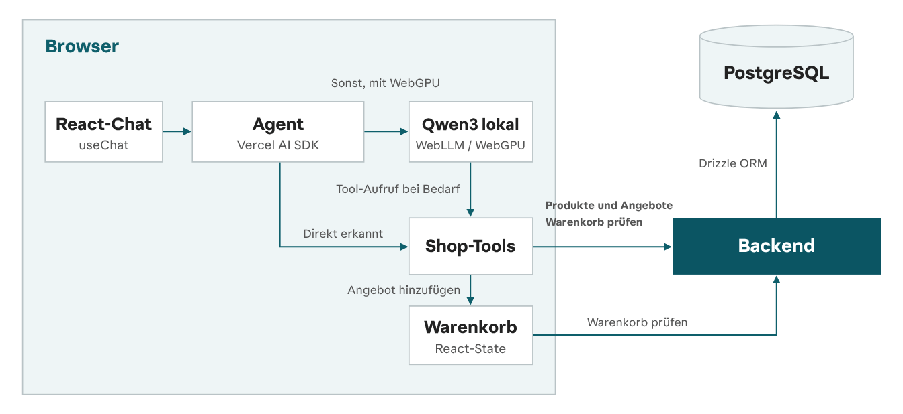

# Requirements – LLM-driven JKU web shop

Nov 5, 2026 · @Basti

The web shop is operated entirely through a chat: a local open-source LLM in the browser recognises what the user wants, and the code controls search, follow-up questions and cart via the Fastify backend. The requirements describe the finished project; the exploratory prototype (v2) is the starting point.

Implementation as issues: Issues (EN)

## Goal and starting point

The goal is a web shop that is operated entirely through a chat (navigation, search, filters, cart) and that turns abstract wishes such as “Put together a summer outfit for me” into concrete backend calls.

## Architecture at a glance

*Architecture · browser and backend*

Everything except the backend runs in the browser:

- **React chat** (`useChat`) passes each message to the **agent** (Vercel AI SDK).
- Input the agent recognises directly (e.g. an option click or “No. 2”) goes straight to the **shop tools**, without the model.
- Everything else goes to **Qwen3**, running locally via WebLLM/WebGPU, which calls a shop tool when needed.
- The shop tools load products and offers from the **backend** and add the chosen offer to the **cart** (React state).
- The backend checks the cart and reads the data from **PostgreSQL** via Drizzle ORM.

## Functional Requirements

### Chat and UI

| ID    | Requirement                                                     | Acceptance criterion                                                                                            | Priority |
|-------|-----------------------------------------------------------------|-----------------------------------------------------------------------------------------------------------------|----------|
| FA-01 | The chat is the only control for search, filters and cart.      | Every action works by text; buttons only send text that Nice to have also be typed.                                    | Must     |
| FA-02 | Follow-up questions offer clickable answer options.             | Each follow-up question has 2–6 options; a click acts like typing.                                              | Must     |
| FA-03 | Results appear as numbered product cards.                       | A card shows number, name, category, brand and starting price; the numbers work for “No. 2”.                    | Must     |
| FA-04 | The cart is always visible next to the chat.                    | Items with variant, quantity, unit price and subtotal; updated after every message.                             | Must     |
| FA-05 | “New” starts an empty conversation but does not empty the cart. | Afterwards the conversation state and shown products are reset, the cart is not empty.                          | Must     |
| FA-06 | Loading and errors are understandable for non-experts.          | Progress during the model download; separate messages for missing WebGPU, unreachable backend and model errors. | Must     |
| FA-07 | Replies are in English and free of jargon.                      | No IDs, no JSON, no field names in bot replies (only in the transparency view).                                 | Must     |
| FA-08 | The cart can be emptied.                                        | The cart is only emptied on an explicit request.                                                                | Must     |
| FA-09 | Users can only chat with the AI in English.                     | The AI tells the user that the web shop is in English.                                                          | Must     |

### Recognition

| ID    | Requirement                                                                                                                                                                                                                                                                                                        | Acceptance criterion                                                                                                                                                                                                                                                                                                                 | Priority |
|-------|--------------------------------------------------------------------------------------------------------------------------------------------------------------------------------------------------------------------------------------------------------------------------------------------------------------------|--------------------------------------------------------------------------------------------------------------------------------------------------------------------------------------------------------------------------------------------------------------------------------------------------------------------------------------|----------|
| FA-10 | The LLM does not answer the message; it translates it into exactly one JSON object with fixed fields: intent, product, category, gender, size, colour, price, number, quantity.                                                                                                                                    | Example: “rain jacket for men under €150” gives {"intent":"search", "product":"rain jacket", "gender":"male", "maxPriceEur":150}. WebLLM enforces the schema, so only allowed fields and values occur; 100 % valid JSON in the test run. The code, never the model, produces the reply text, the search and the follow-up questions. | Must     |
| FA-11 | Recognised intents cover the whole shopping process. The intent is what someone wants to achieve with the message, regardless of wording. Example: “I need headphones”, “Do you have headphones?” and “Show me headphones” are the same intent: search. “Take the second one”, on the other hand, is: add to cart. | Besides search, outfit, add_to_cart, unclear, off_topic also: change quantity (“2 of those”), remove (“Take the jacket out”), details (“Is No. 2 waterproof?”), comparison (“Compare No. 1 and No. 3”), checkout (“Go to checkout”), voucher (“Code STUDENT20”).                                                                     | Must     |
| FA-12 | English words are recognised even with mistakes.                                                                                                                                                                                                                                                                   | “I need a rain jakcet for men in M under 150 €” gives rain jacket, men, M, max. €150.                                                                                                                                                                                                                                                | Must     |
| FA-13 | Unrelated topics and prompt injection are rejected.                                                                                                                                                                                                                                                                | off_topic, no backend call, polite pointer to the shop.                                                                                                                                                                                                                                                                              | Must     |
| FA-14 | The code recognises unambiguous input without the model.                                                                                                                                                                                                                                                           | Click on an option or variant, “No. 1 and No. 3”, “the first one”, product name plus a buying word: 0 tokens.                                                                                                                                                                                                                        | Must     |
| FA-15 | At most one model call per message.                                                                                                                                                                                                                                                                                | No follow-up call after a backend result.                                                                                                                                                                                                                                                                                            | Nice to have   |

### Validation in code

A small language model invents values, confuses intents and can be manipulated by crafted input. Its output is therefore treated as untrusted input, just like a form field a user fills in: the code checks every value against the user's text, the conversation state and the allowed values before it is used.

| ID    | Requirement                                                                                                                                                                   | Acceptance criterion                                                                                                                                                                                                                                                                                                                                                                                                                                                         | Priority |
|-------|-------------------------------------------------------------------------------------------------------------------------------------------------------------------------------|------------------------------------------------------------------------------------------------------------------------------------------------------------------------------------------------------------------------------------------------------------------------------------------------------------------------------------------------------------------------------------------------------------------------------------------------------------------------------|----------|
| FA-20 | Invented values are removed.                                                                                                                                                  | Size, colour, gender, price, quantity and number are kept only if they appear in the text or were settled earlier in the conversation; otherwise a note in the validation step.                                                                                                                                                                                                                                                                                              | Must     |
| FA-21 | Prices come from the text, never from the search term.                                                                                                                        | “under €100” becomes maxPrice, even if the model puts it into product.                                                                                                                                                                                                                                                                                                                                                                                                       | Must     |
| FA-22 | The model's output is never used unchecked, not even the recognised intent. The code checks whether the intent fits the message and the situation, and corrects it otherwise. | The code checks every intent coming from the model and changes wrong ones: adding to the cart without shown products or without a buying word becomes “search”; an outfit with fewer than 2 items becomes “search”; off_topic clears all fields. Every JSON object goes through this check before any backend call, cart change or reply; every correction is shown in the transparency view. Test: wrong intent, invented size, wrong price and wrong number are corrected. | Must     |
| FA-23 | Invalid model output does not cause a crash.                                                                                                                                  | No JSON or wrong schema: friendly follow-up question, state is kept.                                                                                                                                                                                                                                                                                                                                                                                                         | Must     |
| FA-24 | The model only suggests; the code decides and acts.                                                                                                                           | The model has no access to backend or cart; only the code calls endpoints and changes the cart. Categories, intents and gender come only from fixed lists, products only from the “last shown” list, prices and voucher codes only from the user's text. Prompt injection therefore cannot trigger any action.                                                                                                                                                               | Must     |

### Conversation state

| ID    | Requirement                                               | Acceptance criterion                                                                                            | Priority |
|-------|-----------------------------------------------------------|-----------------------------------------------------------------------------------------------------------------|----------|
| FA-30 | The code, not the model, keeps the conversation state.    | The state holds settled details, the open follow-up question, shown products and the cart.                      | Must     |
| FA-31 | Answers to follow-up questions complete the open request. | Category → colour → size: all filters are kept until the result; no question is asked twice.                    | Must     |
| FA-32 | Settled details apply to follow-up searches.              | After “men”, “Show me trousers” searches men's products only; the same for size and budget.                     | Nice to have   |
| FA-33 | Details can be changed or cleared.                        | “Actually for women”, “no price limit”, “any colour” affect the next search.                                    | Nice to have   |
| FA-34 | References to earlier results are resolved.               | “The second one” refers to the last list; “the jacket from before” to the most recently shown matching product. | Nice to have   |

## Functional requirements – search, outfits, cart, transparency

### Search in the backend

| ID    | Requirement                                                                                   | Acceptance criterion                                                                                                      | Priority |
|-------|-----------------------------------------------------------------------------------------------|---------------------------------------------------------------------------------------------------------------------------|----------|
| FA-40 | GET /search finds similar products. This endpoint is essential for finding products reliably. | German terms via synonyms, typos up to 1 character, hits in the name ranked before brand/attributes before description.   | Must     |
| FA-41 | The search filters by every attribute in the dataset.                                         | Category (ID or name), gender (unisex always matches), colour, size, min/max price in cents, matchAll, limit 1–50.        | Must     |
| FA-42 | Invalid parameters are rejected.                                                              | HTTP 400 with a message for an unknown category, min \> max, limit outside 1–50.                                          | Must     |
| FA-43 | Too many results (more than 8) lead to a follow-up question.                                  | Ask only about attributes that really narrow the results and are not set yet; otherwise show the first 8.                 | Must     |
| FA-44 | No results lead to an alternative.                                                            | Filters are relaxed one by one (price, size, colour, gender); the reply says what was dropped; otherwise “not available”. | Must     |
| FA-45 | Products outside the range are recognised.                                                    | “Fridge”: note that it is not available, plus the 6 categories as options.                                                | Must     |

### Abstract requests and outfits

| ID    | Requirement                                                          | Acceptance criterion                                                                                                                                                                 | Priority |
|-------|----------------------------------------------------------------------|--------------------------------------------------------------------------------------------------------------------------------------------------------------------------------------|----------|
| FA-50 | An outfit request is searched item by item.                          | Up to 2 suggestions per item, grouped and numbered.                                                                                                                                  | Must     |
| FA-51 | Outfit items must really match.                                      | Every suggestion covers all terms of its item (matchAll); missing items are named, e.g. “only available for women”.                                                                  | Must     |
| FA-52 | Season and weather terms are mapped to items and attributes in code. | Table in code, not in the model: summer, winter, rain, cold, sun. Example winter → down jacket, beanie, gloves, scarf. Each term returns at least 2 matching items from the dataset. | Must     |
| FA-53 | Occasions lead to guided follow-up questions.                        | “Gift”, “start of studies”, “exam preparation”: questions about recipient or budget, or suggestions via tags such as starter-set, student.                                           | Nice to have   |
| FA-54 | A budget applies to the whole outfit.                                | “Summer outfit under €100”: total of the cheapest suggestions ≤ €100, or a note on what exceeds the budget.                                                                          | Nice to have    |
| FA-55 | A colour applies to all outfit items.                                | “Everything in black” filters every item by black, relaxed per item.                                                                                                                 | Nice to have    |

### Product details

| ID    | Requirement                                   | Acceptance criterion                                                                                                                       | Priority |
|-------|-----------------------------------------------|--------------------------------------------------------------------------------------------------------------------------------------------|----------|
| FA-60 | Questions about a shown product are answered. | “Is No. 2 waterproof?” loads `GET /products/:id` and shows description, attributes, variants with price, availability and delivery time. | Nice to have   |
| FA-61 | Two shown products can be compared.           | “Compare No. 1 and No. 3”: table with price, brand and key attributes.                                                                     | Nice to have   |

### Cart and checkout

| ID    | Requirement                                                | Acceptance criterion                                                                                                                                 | Priority |
|-------|------------------------------------------------------------|------------------------------------------------------------------------------------------------------------------------------------------------------|----------|
| FA-70 | Products are added to the cart by number, ordinal or name. | Several at once; variant from the text or via a follow-up question, one product after another.                                                       | Must     |
| FA-71 | The cart can be changed via chat.                          | “Take the jacket out”, “2 of those”, “Empty the cart” take effect immediately and are confirmed.                                                     | Must     |
| FA-72 | The offer per variant follows a goal.                      | Default: cheapest in-stock offer; on request fastest delivery or fewest packages.                                                                    | Nice to have   |
| FA-73 | “Go to checkout” checks the cart via POST /validate.       | Shows packages per vendor and warehouse, shipping, package tax, delivery time, total; every problem (e.g. OUT_OF_STOCK) explained with a suggestion. | Nice to have    |
| FA-74 | Vouchers are redeemed via chat.                            | “Code STUDENT20” is checked via /validate; discount or reason for rejection (expired, minimum order value, wrong category).                          | Nice to have   |
| FA-75 | The rate limit of /validate is respected.                  | Called only at checkout or for a voucher; on HTTP 429 a note with the waiting time, no crash.                                                        | Nice to have     |
| FA-76 | Quantities match the stock.                                | More than available (LITTLE = 10) leads to a note and an alternative offer.                                                                          | Nice to have   |

### Transparency and self-correction

| ID    | Requirement                                           | Acceptance criterion                                                                                                     | Priority |
|-------|-------------------------------------------------------|--------------------------------------------------------------------------------------------------------------------------|----------|
| FA-80 | Every reply shows what happened in the background.    | Expandable: recognition (model or code), validation, flow with every backend call, its parameters and number of hits.    | Nice to have   |
| FA-81 | A plain-language status line appears while working.   | e.g. “Searching rain jackets for men …” instead of “Model is thinking …”.                                                | Nice to have    |
| FA-82 | Failed backend calls are corrected automatically.     | HTTP 400 (e.g. unknown category) leads to one corrected second call; the correction is visible in the transparency view. | Nice to have   |
| FA-83 | Empty or oversized results are handled automatically. | Relax filters, drop the category or ask a follow-up question instead of an error message; every step visible.            | Nice to have   |

## Non-functional requirements

| ID     | Requirement                                      | Acceptance criterion                                                                                                                             | Priority |
|--------|--------------------------------------------------|--------------------------------------------------------------------------------------------------------------------------------------------------|----------|
| NFA-01 | Replies are fast.                                | Code recognition including backend under 0.3 s; message with model at most 4 s (Qwen2.5 3B, measured 2–3 s); GET /search under 50 ms.            | Must     |
| NFA-02 | Startup after the first time is short.           | The model loads from the browser cache and is ready in under 30 s; progress in percent on first load.                                            | Nice to have   |
| NFA-03 | Chat texts stay local.                           | No cloud LLM, no trackers; only search parameters and offer IDs go to the backend.                                                               | Must     |
| NFA-04 | The application does not crash.                  | No unhandled exception in the console in any test run or dialog case; every error appears as a message in the chat.                              | Must     |
| NFA-05 | Supported browsers are defined.                  | Current Chrome and Edge on Windows and macOS; without WebGPU a clear message instead of a blank page.                                            | Must     |
| NFA-06 | The logic is testable without browser and model. | Model and fetch are replaceable; pnpm test runs without GPU and without a running server.                                                        | Must     |
| NFA-07 | The code stays maintainable.                     | Strict TypeScript; any only at library boundaries; one module per task; API types from backend/src/types.ts; openapi.yaml up to date.            | Must   |
| NFA-08 | Structure and decisions are documented.          | README with setup, architecture and modules; justification of “recognition in the model, flow in code” with measurements for the project report. | Must     |
| NFA-09 | The chat can be used without a mouse.            | Keyboard for everything, focus back in the input after sending, chat as aria-live, sufficient contrast in light and dark mode.                   | Nice to have   |
| NFA-10 | The model is replaceable.                        | Switching the model via the selector without code changes; prompt and schema work for all offered models.                                        | Nice to have   |

## Risks and open questions

| Risk                                                                 | Impact                                      | Mitigation                                                                                         |
|----------------------------------------------------------------------|---------------------------------------------|----------------------------------------------------------------------------------------------------|
| The assessment computer has no WebGPU or too little graphics memory. | The model does not load and the demo fails. | Test early on the target device; Qwen2.5 1.5B as fallback; bring our own demo laptop.              |
| First download of about 2.5 GB.                                      | Long wait during the presentation.          | Load the model beforehand; it stays in the browser cache.                                          |
| More intents (FA-11) confuse the small model.                        | Accuracy in the test run drops.             | Run the test run before and after every extension; handle unambiguous cases with code recognition. |
| Rate limit of POST /validate (5 per minute).                         | Tests and demo run into HTTP 429.           | Call it only at checkout; replace the call in tests.                                               |
| Dataset without season tags.                                         | Summer and winter outfits find too little.  | Mapping table season → items in code, with a test per term against the dataset.                    |
| The base repository keeps evolving in the course.                    | Conflicts with our own /search extension.   | Keep /search in separate files; merge changes from the base repository regularly.                  |
